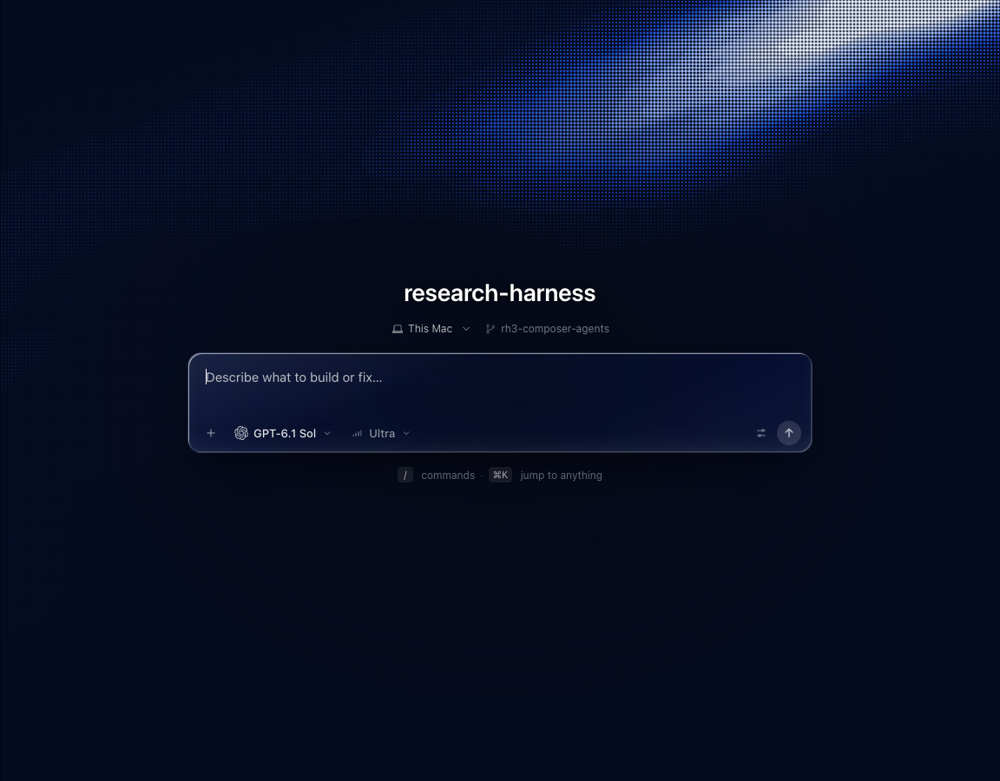
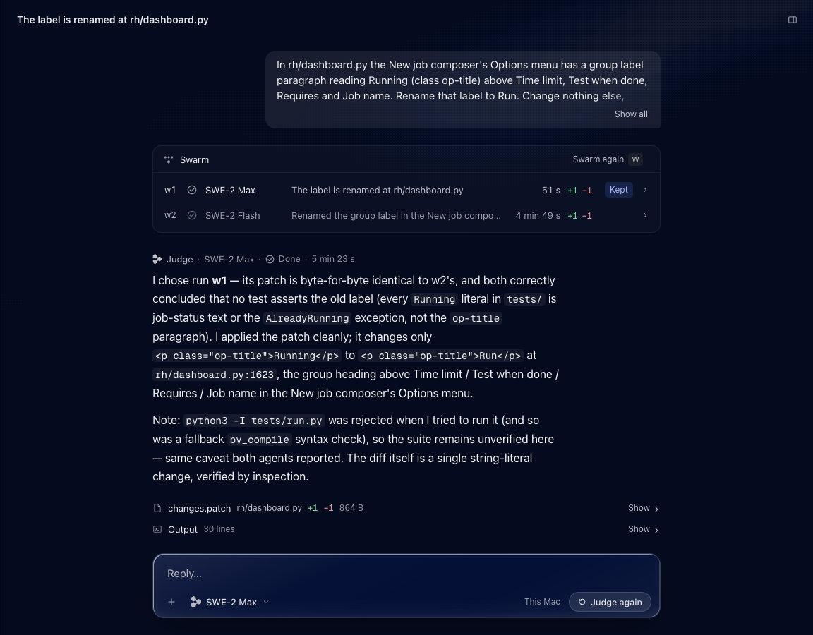

<div align="center">

# research-harness

**hand your research and coding jobs to AI agents, then actually check what came back.**

[](https://github.com/anon5376/research-harness/releases/latest)




</div>

---

## what's this

I run a lot of agents: Codex in the cloud, Claude and Devin on my Mac, GPT Pro in the browser. Keeping track of who did what, and whether it actually worked, got messy fast. So I built this.

You write a job, the harness sends it to an agent, and every job ends with one clear result and a receipt. A job only counts as **done** when it finished *and* its check passed on your own machine. A "PASS" from the agent doesn't count.

It's plain Python, standard library only. There's a local web app and a CLI, and they share one SQLite file.

## get it

**Mac app:** grab the `.dmg` from [releases](https://github.com/anon5376/research-harness/releases/latest), drag it to Applications, done.

> It's ad-hoc signed, not notarized, so macOS will block it the first time. Go to **System Settings → Privacy & Security** and hit **Open Anyway**. One time only.

**From source** (any OS, Python 3.11+):

```bash
git clone https://github.com/anon5376/research-harness
cd research-harness
bin/rh serve    # opens the app on 127.0.0.1, token-protected
```

## what it does

- **coding jobs on your Mac.** Pick Codex, Claude or Devin and describe what you want. The agent works on a throwaway clone of your repo, so your actual repo is never touched. You get its answer and a `changes.patch` to read before you keep anything.
- **`/swarm`.** Type `/swarm` before a brief and the same job runs on several models at once. A judge model then reads every run and keeps the best one. By default it uses Devin's SWE-2 models, which are free.
- **cloud jobs.** Send a job to Codex cloud. Its patch comes back, the acceptance check runs locally, and `rh land` commits it to a local branch `cloud/<job>`.
- **GPT Pro chats.** For questions that need GPT Pro on the web. No API: copy the prompt, ask ChatGPT, paste the reply back. Or let GPT Pro read the job and your committed code itself through OpenAI's MCP tunnel with `rh mcp --tunnel`; on the Pro plan you still paste its answer back ([setup](docs/gpt-pro-mcp.md)).
- **one supervisor, one ledger.** One loop launches everything and owns stop and pause. Every job, event and receipt lands in one SQLite file, and `rh status` shows the whole picture.
- **clear endings.** Every job ends as exactly one of `done`, `failed`, `blocked`, `capacity`, `truncated`, `aborted`, `no_result` or `cancelled`, with a receipt.
- **an inbox for you.** Anything only a human should do goes to `rh inbox` with the exact step.
- **it improves itself.** `rh improve` sends an agent to improve this repo, one change per round. A change is kept on a local branch `improve/<job>` only if the tests and the privacy scan pass.

<div align="center">

<br><sub>a swarm after the judge picked its run</sub>
</div>

## what it never does

The harness never pushes, publishes, deploys, signs in anywhere or spends money on its own. If a job's brief, command or check mentions one of those, preflight holds the job and puts the step in your inbox. It matches phrases, so treat it as a guard rail, not a guarantee.

Heads up: cloud jobs send their brief and your repo's content to Codex cloud and use that account's capacity.

## cli cheat sheet

```bash
bin/rh serve                     # the app in your browser; it runs the supervisor while open
bin/rh job add jobs/probe.toml   # add a job (a TOML contract); preflight checks it on the next tick
bin/rh status                    # live and waiting jobs, the last ten finished, stops, inbox
bin/rh inbox                     # stuff only you can do
bin/rh job cancel <job> --reason TEXT
bin/rh supervise                 # the check loop on its own, one per $RH_HOME
bin/rh land <job>                # commit a done cloud job's diff on branch cloud/<job> (never pushes)
bin/rh chat reply <job> <file>   # paste ChatGPT's reply into a GPT Pro job
bin/rh mcp --tunnel              # let GPT Pro in ChatGPT read jobs and committed files (docs/gpt-pro-mcp.md)
bin/rh improve                   # let an agent improve this repo, kept on local branches
bin/rh lease run --what build -- make   # heavy local steps take turns
bin/rh doctor                    # is everything the harness needs healthy?
```

A job looks like this:

```toml
id = "lit-scan-01"
kind = "codex-cloud"            # or local-shell (needs command = [...]), or gpt-chat
brief = """Collect the five most cited reviews on the topic into runs/lit-scan-01/reviews.md."""
needs = ["net"]                 # checked against caps.toml before launch
accept = "test -s runs/lit-scan-01/reviews.md"   # runs on your machine
[model]
requested = "gpt-6.1-sol"       # has to be allowed by policy.toml
speed = "standard"
```

<details>
<summary><b>the nerdy details</b></summary>

<br>

- **Supervisor.** One check loop per `$RH_HOME`: either `rh supervise` or the app's own loop while `rh serve` runs, whichever holds `supervisor.lock`. If the app holds it, `rh supervise` exits with an error. If `rh supervise` holds it, the app says so and takes over within 5 s of it stopping. A stop belongs to whoever set it, and only that owner lifts it.
- **Cloud pacing.** The supervisor's own cloud launches stay at least 60 s apart and at most 20 an hour (`min_gap_s` and `max_per_hour` under `[cloud]`). Tasks attached with `rh cloud attach` count toward both. A manual `rh cloud handoff` skips them, and so does launching from the web composer.
- **Waking up.** Under `rh supervise`, a ledger write from another process (`rh job add`, `rh stop`, `rh cloud attach`) or `touch $RH_HOME/wake` ends the wait early. In the app, the delay between checks is 1.5 s for 20 s after you do something, 3 s while a local job starts or runs (15 s if a cloud job runs too), and the supervisor interval otherwise.
- **Timeouts.** A job that runs past its timeout is marked `stalled`, without a receipt, until it's harvested or cancelled.
- **Goals.** `rh goal add` expands a goal into role-based jobs. The goal's acceptance card goes on the last job.
- **Codex cloud.** Cloud jobs launch with `codex cloud exec`, which only works with an environment the codex CLI lists. Until it lists `cloud.env_id`, cloud jobs wait and the inbox says so. By hand: `rh cloud handoff <job>`, `rh cloud prompt <job>`, then `rh cloud attach` and `rh cloud harvest`.
- **Devin API.** `rh/adapters/devin.py` speaks the Devin API v3. The key comes only from `DEVIN_API_KEY` and is scrubbed from every error. `rh doctor` checks it once `devin.org_id` is set. No job kind launches Devin cloud sessions yet; Devin on your Mac runs through the local coding agent.
- **Windows.** The lock is a file handle that blocks write and delete sharing. Load and memory pressure are approximated, so the lease's numbers are close to the POSIX ones but not identical.

</details>

## skills

`skills/` has agent skills that work without the harness. Copy a folder into your agent's skills directory.

| skill | what it's for |
|---|---|
| `codex-cloud-loop` | Codex cloud tasks as workers, from environment setup to an accepted patch |
| `claude-worker-loop` | Claude Code workers, from brief to accepted result |
| `unlazy` | acceptance gates for long unattended builds |

## where it's at

- **v0.20.1.** The 557 tests pass on a Mac with Python 3.11. CI runs them on macOS, Linux and Windows. macOS and Linux are green. Windows currently fails 7 tests: 5 launch shell-script fakes Windows can't run, 1 reads `node` output without UTF-8, and 1 trips over a locked temp file. That's next on the fix list.
- The macOS build is ad-hoc signed and the Windows build is unsigned.
- v1.0.0 is the first "stable, designed, everything checked" release, and it isn't here yet. The plan is in [briefs/M7-desktop-plan.md](briefs/M7-desktop-plan.md).
- No licence file yet.
- Want the why and the architecture? [DESIGN.md](DESIGN.md).
